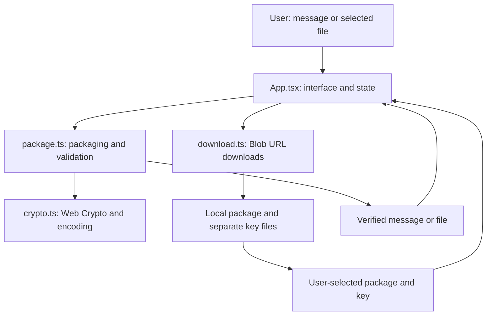

# Design and architecture

This document describes the implemented Secure Packager application. The rationale below explains the benefits and costs of the current design; it is inferred from the implementation, rather than a historical record of the author's decisions.

## System boundaries

Secure Packager is a browser application built with React, TypeScript, and Vite. Its application logic runs locally: it reads user-selected files, performs cryptographic operations through Web Crypto, and creates local downloads. There is no application API, database, account system, or server-side key service.

The browser loads the application from a development server or static host. That host remains part of the trust boundary because it supplies the JavaScript that handles plaintext and keys. Web Crypto requires a secure context, such as localhost for development or HTTPS for deployment.



## Module responsibilities

| Module | Responsibility | Boundary |
| --- | --- | --- |
| `src/main.tsx` | Mounts React in strict mode | Application entry point |
| `src/App.tsx` | Coordinates input, asynchronous operations, errors, and downloads | Calls utilities; does not implement cryptographic algorithms |
| `src/utils/package.ts` | Builds payloads and envelopes; validates imports and recovered content | Treats parsed JSON as untrusted data |
| `src/utils/crypto.ts` | Hashes bytes, generates/imports/exports keys, encrypts/decrypts, and converts Base64 | Delegates cryptographic primitives to Web Crypto |
| `src/utils/download.ts` | Downloads text or binary Blobs | Creates and later revokes temporary object URLs |

This separation lets Node.js tests exercise encryption and package validation without mounting React. The UI remains one component, which keeps a small demo easy to follow but concentrates many state variables and event handlers in one file.

## Data flow and format

For a message, `createMessagePackage` hashes its UTF-8 bytes, encrypts a JSON payload, decrypts that payload immediately, and verifies the recovered hash. For a file, `createFilePackage` hashes the original bytes and encrypts a file payload. File creation does not perform an immediate recovery check.

The outer package has this shape; angle-bracket values below are explanatory placeholders:

```json
{
  "version": 1,
  "algorithm": "AES-GCM",
  "iv": "<Base64-encoded 12-byte IV>",
  "ciphertext": "<Base64-encoded encrypted payload and authentication tag>"
}
```

The encrypted message payload contains `message` and `hash`. The encrypted file payload contains `kind: "file"`, `name`, `mimeType`, Base64 `content`, and `hash`. Hashes are lowercase hexadecimal SHA-256 strings. File metadata is encrypted with the content; the outer envelope exposes the format version, algorithm, IV, and approximate content size.

The separate key file holds a Base64-encoded raw 32-byte AES key. Base64 is an encoding and provides no secrecy. Imported keys are non-exportable and have only the `decrypt` usage; generated keys are exportable and support both encryption and decryption.

Creation checks the exact byte size of its pretty-printed JSON package against the import limit before offering it for download. `openUploadedPackage` checks upload sizes before reading, parses and validates the envelope, decodes the IV and ciphertext, checks the IV length, imports the key, and decrypts. It then validates the plaintext structure and recalculates its content hash. Only successfully verified content is returned to the UI.

## Design decisions and tradeoffs

| Decision | Rationale | Cost or limitation |
| --- | --- | --- |
| Browser-only processing | Demonstrates local encryption without operating a backend or uploading user content | Page scripts and the device must be trusted; there is no server recovery service |
| React with strict TypeScript | Provides state-driven rendering and compile-time checks for application data | External JSON still needs runtime validation; types cannot validate uploaded bytes |
| Web Crypto primitives | Avoids implementing encryption or hashing algorithms in application code | Requires compatible browser APIs and a secure context |
| AES-256-GCM | Combines encryption with authentication of the encrypted payload | Key secrecy and correct IV handling remain essential |
| New key per package and random 12-byte IV | Keeps each package independent and avoids intentionally reusing key/IV pairs | Users must retain and correctly associate a separate key with every package |
| SHA-256 inside the encrypted payload | Makes hashing and post-decryption integrity comparison visible for the class demonstration | AES-GCM already authenticates the payload; the extra hash does not establish sender identity |
| JSON envelope with Base64 binary fields | Makes package structure easy to inspect and save as a text file | Increases size and memory use, especially for files encoded inside an encrypted JSON payload |
| Explicit version and algorithm checks | Rejects unsupported formats before attempting recovery | Version 1 is the only supported format; no migration mechanism exists |
| Separate package and raw key downloads | Enables later recovery without passwords or account infrastructure | The key download is unprotected; possession of both files permits decryption |
| Runtime validation before returning content | Prevents malformed or mismatched recovered data from reaching the result area | Validation is deliberately small and is not a complete JSON schema implementation |
| Generic binary recovery download | Avoids rendering uploaded file content within the application | Original MIME type is not restored, and downloaded files are not scanned |

## Interface and failure behavior

Creation and import maintain separate state and busy flags. Message and source-file creation share an output area; changing either input clears those results. Changing an import input clears the previous recovered content. Buttons and inputs for each workflow are disabled while that workflow runs.

Labels, section headings, visible focus styles, alert messages, and live result regions support interface usability. These features are present in the source; a full accessibility audit has not been performed.

Import errors use one UI message covering incorrect keys, damaged or unsupported packages, and size limits. Utility functions throw more specific validation errors where applicable. Failed import operations do not return recovered content. Plaintext still necessarily exists inside the application during decryption and verification.

## Resource limits and known gaps

| Input | Current limit |
| --- | --- |
| Source or recovered file | 4 MiB |
| Uploaded package | 8 MiB |
| Uploaded key | 1 KiB |
| Message at creation | No fixed character limit; reject if its generated package exceeds 8 MiB |

File bytes are Base64-encoded in the payload, then the encrypted payload is Base64-encoded again. A prior 5 MiB source-file limit allowed a 9,321,004-byte pretty-printed package that exceeded the 8 MiB import limit. The source-file limit is now 4 MiB, and creation checks the exact downloaded package size for both files and messages. A boundary test confirms that a maximum-size file can be reopened.

Other boundaries include whole-file processing in memory, no explicit plaintext/key memory wiping, no persistent key management, and no protection against compromised scripts or devices. Filename handling strips directory prefixes but is not comprehensive filename sanitization. The file's content hash covers its bytes, while GCM protects the encrypted payload including its metadata. Anyone holding the key can construct a new valid package, so verification does not identify an author.

## Validation and future changes

The automated suite checks known SHA-256 vectors, round trips, key export/import, IV freshness, tampering rejection, binary recovery, filename handling, malformed structures, hash mismatch, the maximum supported file round trip, and oversized inputs. TypeScript compilation and ESLint provide additional checks. Browser interaction and download behavior are not covered by the automated suite.

Later improvements could add browser workflow tests, extract UI components as the application grows, and introduce password-protected key export with a separately designed and versioned format. These are proposals, not implemented features.

## Source references

- [Interface](../src/App.tsx)
- [Package creation and validation](../src/utils/package.ts)
- [Cryptographic helpers](../src/utils/crypto.ts)
- [Download helpers](../src/utils/download.ts)
- [Cryptographic tests](../tests/crypto.test.mjs)
- [Package tests](../tests/package.test.mjs)
